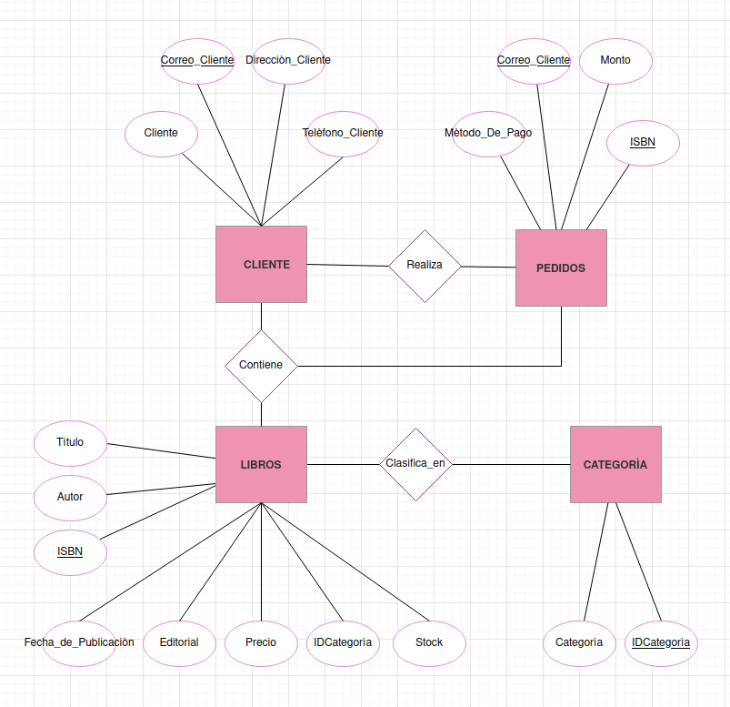
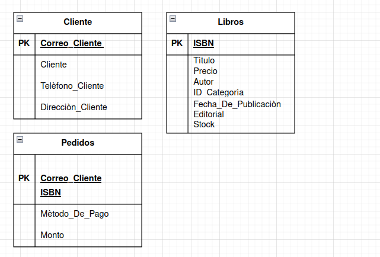

# 📚 Tienda de Libros · Normalización de Bases de Datos

[](https://github.com/allisonrvargas/Tienda-de-Libros/actions/workflows/ci.yml)
[](LICENSE)

Diseño de la base de datos de una tienda de libros a partir de una tabla sin normalizar. Apliqué paso a paso la **primera, segunda y tercera forma normal** y terminé con el diagrama entidad-relación y el diagrama UML.

**Temas:** normalización (1FN, 2FN, 3FN) · claves primarias y foráneas · modelado E-R · UML

# Parte 1: Normalización


## Primera forma normal - Convertir todos los campos en valores atómicos y garantizar que todas las filas tengan PK


JUSTIFICACIÓN: La primera forma normal, dice que deben ser atómicos lo que quiere decir que no se pueden dividir en ningún campo, por lo cual el ejercicio dado ya estaba resuelto, ya que cada fila debe tener un identificador (único), y en los campos no puede tener varios valores en la misma celda tal motivo este ejercicio cumplia con los aspectos. En resumen, el ejercicio dado, cada celda cumplía con tener un valor único, y todas las filas tenían un ID (CitaID), como valor primario, así que la tabla se mantuvo su estructura original.


## Segunda forma normal - todos los atributos (campos o columnas) deben depender de sus propias claves


La segunda forma normal dice que, todos los atributos que no forman parte de la clave primaria deben depender de forma funcional es decir por si sola, completa de toda la clave primaria y no de una parte de ella por tal eliminando la dependencia parcial. En el ejercicio original, la tabla mezclaba datos de libros, clientes y transacciones bajo una clave compuesta implícita. Atributos como el Título, Autor, Precio y Stock solo dependían del ISBN (clave del libro), mientras que Cliente, Teléfono y Dirección dependían exclusivamente del Correo Cliente. Por tal motivo, para cumplir con la 2FN, se dividió en partes, la estructura original en tres tablas independientes: Libro (maestro de libros), Cliente (maestro de clientes) y Método de pago / Pedidos (tabla relacional de transacciones). De esta manera, se eliminó la redundancia de datos (como la duplicación de los registros de Juan Pérez) y se garantizó que cada columna dependa únicamente de su clave correspondiente.
## Tercera forma normal - No debe haber dependencias transitivas


La tercera forma normal dice que se deben eliminar las dependencias transitivas, lo que que quiere decir que ningún atributo no primo puede depender de otro atributo no primo; todos deben depender directamente de la clave primaria. Al revisar la tabla Libros resultante de la 2FN, se identificó que el campo Categoría dependía directamente del género literario y no del ISBN del libro en sí (generando una dependencia transitiva). Para resolver esto y alcanzar la 3FN, se extrajo la información creando una nueva tabla maestra llamada Categoría, asignándole un identificador único (ID Categoría como PK). Luego, este ID se vinculó a la tabla Libros como una clave foránea (FK). Las tablas de Clientes y Pedidos se mantuvieron intactas ya que sus atributos dependían de forma directa y no transitiva de sus respectivas claves primarias. Con este proceso se logró una mejor estructura de las tablas.

# Parte 2: Diagrama Conceptual de Entidad-Relación


# Parte 3: Diagrama UML E-R


# Parte 4: Implementación en SQL

El diseño en tercera forma normal está implementado en PostgreSQL, con los datos de ejemplo del ejercicio:

| Archivo | Contenido |
| --- | --- |
| [`sql/01_esquema.sql`](sql/01_esquema.sql) | Tablas `categoria`, `libro`, `cliente` y `pedido` con claves primarias, foráneas y restricciones |
| [`sql/02_datos.sql`](sql/02_datos.sql) | Las 3 categorías, 3 libros, 2 clientes y 3 pedidos de la tabla de la 3FN |
| [`sql/03_consultas.sql`](sql/03_consultas.sql) | 5 consultas de ejemplo (JOIN, GROUP BY y LEFT JOIN) |

```text
CATEGORIA (id_categoria PK, categoria)
LIBRO     (isbn PK, titulo, autor, fecha_publicacion, editorial, id_categoria FK, precio, stock)
CLIENTE   (correo_cliente PK, cliente, telefono_cliente, direccion_cliente)
PEDIDO    (correo_cliente FK + isbn FK = PK, metodo_pago, monto)
```

## Cómo ejecutarlo

Requiere PostgreSQL 14 o superior. Con Docker:

```bash
docker run --name tienda -e POSTGRES_PASSWORD=postgres -e POSTGRES_DB=tienda -p 5432:5432 -d postgres:16
for f in sql/01_esquema.sql sql/02_datos.sql sql/03_consultas.sql; do
  docker exec -i tienda psql -U postgres -d tienda -v ON_ERROR_STOP=1 < $f
done
```

El CI de este repositorio ejecuta los tres scripts, verifica los datos y comprueba que no se acepte un pedido de un cliente inexistente.

## Licencia

MIT